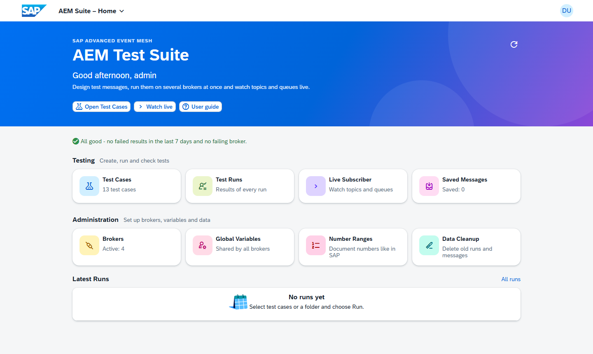
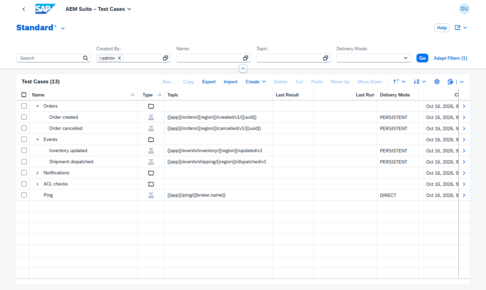
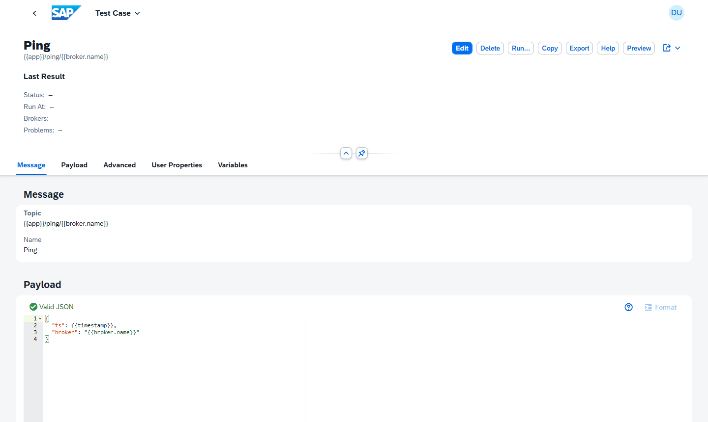
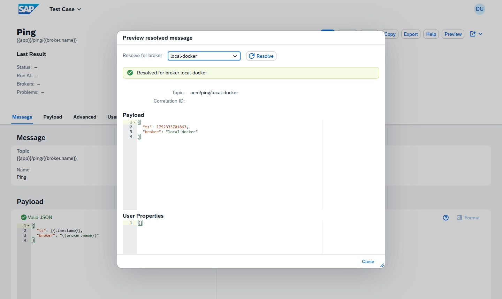
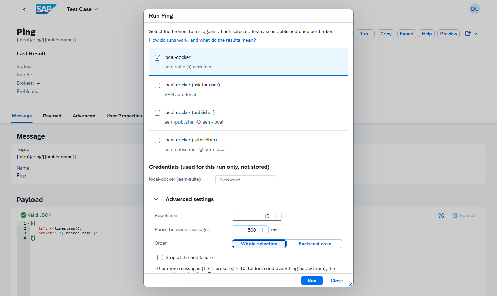
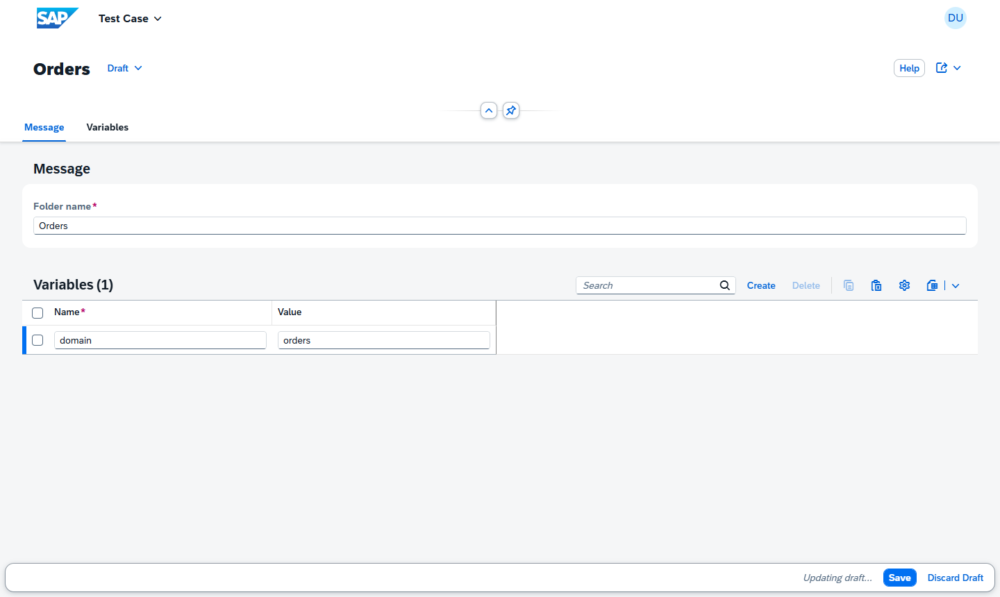
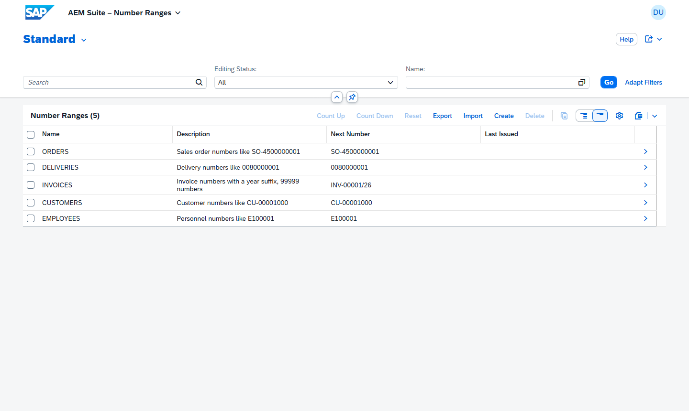
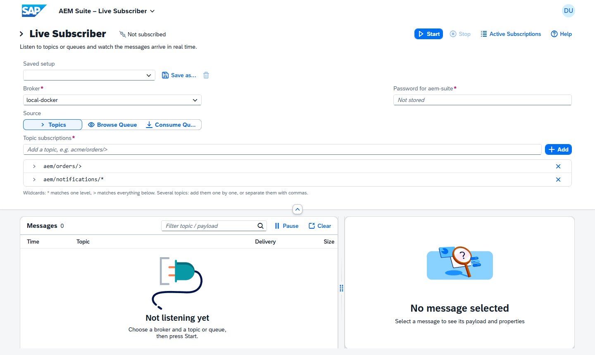
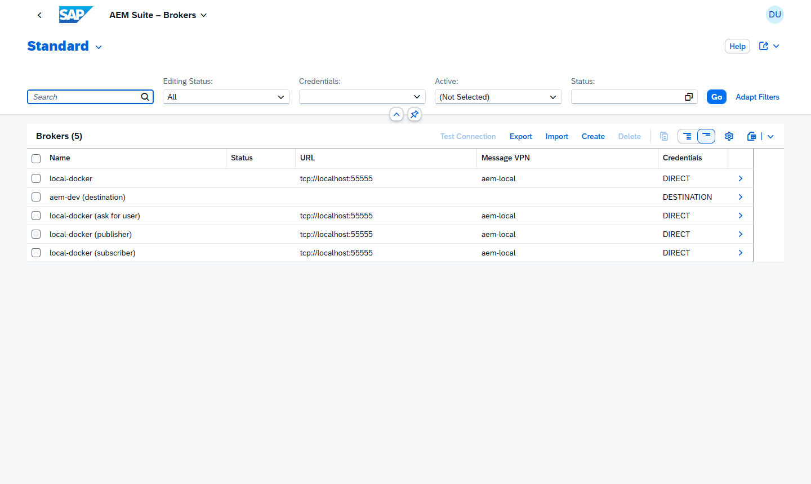
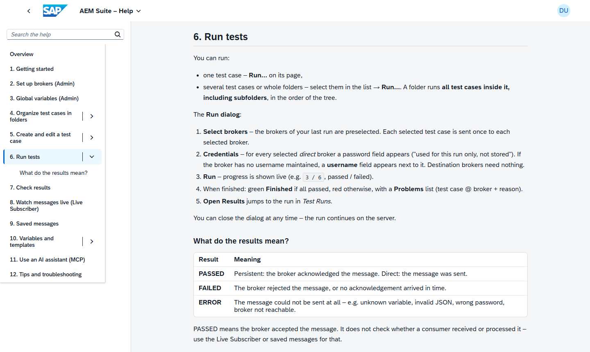

# AEM Test Suite

**Test your SAP Advanced Event Mesh (Solace) brokers without writing code.**
Save messages as test cases, send them to several brokers at once, see immediately which broker accepted them, and watch topics and queues live. Built on SAP CAP and SAP Fiori, ready for SAP BTP (Cloud Foundry).



## Why use it

- **Know if the broker really took it.** A result passes only when the broker acknowledges the message (persistent delivery), with the measured ACK latency.
- **One test, many brokers.** Run a test case or a whole folder against dev, test and prod brokers in parallel, and compare the results per broker.
- **Reusable messages.** Topics, payloads, correlation IDs and user properties accept `{{variables}}` (global, broker, folder and test case level) plus built-ins such as `{{uuid}}`, `{{now}}` or `{{randomInt(1,10)}}`.
- **Realistic test data.** faker.js built in: `{{faker.person.fullName}}`, `{{faker.internet.email}}`, `{{faker.location.city}}` and more, in any language.
- **SAP-like numbers.** Number ranges hand out document numbers such as `SO-4500000001` with `{{numberRange.ORDERS}}`, kept per range and resettable.
- **Passwords stay with you.** Brokers can use a BTP destination, or direct credentials that are asked for on every run and are never stored.
- **Works with your AI assistant.** An MCP endpoint lets GitHub Copilot, Claude Code and other clients plan, preview and run tests for you.
- **Help is built in.** Every app has a Help button that opens the matching section of the user guide, rendered from Markdown.

## Features

### Organize tests in folders

A tree of folders and test cases with drag and drop, copy, cut and paste, and a compact type icon. Folders carry their own variables, run everything below them, and can be exported to a JSON file and imported again (handy for backups and for keeping tests in Git).



### Design the message

Topic, JSON payload with validation and formatting, delivery mode, TTL, priority, DMQ eligibility, correlation ID and SMF user properties. Everything beyond the topic is optional and has sensible defaults.



### See exactly what will be sent

**Preview** resolves all variables for a chosen broker and shows the final topic, payload, correlation ID and user properties. Nothing is sent.



### Run against several brokers

Pick one or more brokers and run. Progress arrives live, and the results are kept per test case and broker. For direct brokers the dialog asks for the password (and for the username if the broker has none); it is used for this run only.



The **advanced settings** of the Run dialog repeat messages (up to 1000 times), pause between them, send the whole selection or each test case in a row, stop at the first failure, and **Stop run** ends a long run early.

### Variables on every level

`{{name}}` is resolved from the test case, then the broker, then the folders (inner first), then the global variables, then the built-ins. Folder variables are maintained right on the folder page.



### Real-looking identifiers with number ranges

Define number ranges the way SAP does (prefix, suffix, number of digits, first number, step, last allowed number) and use them in any message as `{{numberRange.ORDERS}}`: every message gets the next number, for example `SO-4500000001`. Preview shows the next number without using it up, and **Reset** starts the range again. Need one generated number several times in a payload? `{{numberRange.ORDERS as orderNo}}` keeps it in a temporary variable you can reuse as `{{orderNo}}`.



### Watch messages live

Subscribe to topics (wildcards allowed), browse a queue without taking messages, or consume it. Messages stream in over a WebSocket; save them, or turn one into a test case.



### Manage brokers

Maintain broker connections (BTP destination or direct), test the connection, and filter by credentials, status and activity. Broker URLs are completed for you: the host is enough.



### Documentation inside the app

The user guide is rendered from Markdown with navigation, search and links to every heading.



## Quick start

Requires **Node.js 22.12 or newer**.

```sh
npm install
npm run watch
```

Open http://localhost:4004/launchpad.html and sign in as `admin` / `admin` (Admin and Tester) or `tester` / `tester`. The demo data comes with a ready-made set of folders, test cases and brokers.

To test against a real broker locally, start the Solace container from [local/README.md](local/README.md). No broker is needed to explore the apps.

## Use it with an AI assistant

The suite offers an MCP endpoint (`/mcp/agent`). Connect GitHub Copilot, Claude Code or any MCP client, and ask for things like *"Create a folder Inventory with a test case for acme/inventory/updated/v1/{{sku}} and show me how it looks for broker aem-dev"* or *"Run all tests in Orders on aem-dev and tell me what failed."* The assistant can plan, preview and run tests, but cannot delete anything and never receives broker passwords. Setup for Copilot and others: [Use an AI assistant](docs/user-guide.md#11-use-an-ai-assistant-mcp).

## Documentation

| Document | For whom | Content |
|---|---|---|
| [User guide](docs/user-guide.md) | testers, admins | how to use every app, variables, runs, live subscriber, AI assistant, troubleshooting |
| [Technical documentation](docs/technical-documentation.md) | developers, operators | architecture, data model, APIs, security, configuration, deployment, extension points |
| [Local broker](local/README.md) | developers | Solace PubSub+ in Docker with demo users and queues |

## Technology

SAP CAP (Node.js, TypeScript) with OData V4, SAP HANA Cloud, SAP Fiori elements and freestyle SAPUI5 apps, the Solace JavaScript API, XSUAA, the Destination service, the HTML5 Application Repository (also usable from SAP Build Work Zone), and the CAP MCP plugin. Tests: Jest (unit and service integration) and Playwright (browser).

## Screenshots

The images in `docs/images` are generated from the running apps on the demo data. To refresh them after a UI change:

```sh
npm run docs:screenshots
```

---

# Reference

## Architecture

```
Browser ── approuter (XSUAA, websockets) ──┬─ /odata/v4/{admin,test,subscribe,help,home}  OData V4
                                           ├─ /mcp/agent                        MCP for AI assistants (OAuth login via XSUAA)
                                           └─ /ws/live                          WebSocket (run progress, live messages)
CAP srv (TypeScript)
  srv/lib/solace/session.ts            solclientjs session wrapper: connect, publish + ACK, subscribe, queue flows
  srv/lib/solace/subscription-hub.ts   live subscriptions (in memory, per user, heartbeat-based idle timeout)
  srv/lib/test-runner.ts               async multi-broker runs, results + websocket progress
  srv/lib/template/resolve.ts          {{variable}} resolver
  srv/lib/credentials/                 destination / direct connection data, destination value help
HANA Cloud · Destination service · XSUAA
```

| App (`app/…`) | Type | Role |
|---|---|---|
| `testcases` | Fiori elements LR/OP with JSON editor, Run dialog (live progress) and Preview | Tester |
| `runs` | Fiori elements LR/OP | Tester |
| `subscriber` | Freestyle UI5 in TypeScript | Tester |
| `messages` | Fiori elements, saved messages | Tester |
| `brokers`, `variables`, `numberranges` | Fiori elements | Admin |
| `help` | Freestyle UI5 | Everyone: the user guide, rendered from `docs/user-guide.md` |
| `home` | Freestyle UI5 | Everyone: start page with figures, the apps of your roles and the latest runs |

`app/launchpad` is a sandbox launchpad that shows all apps as tiles; the standalone approuter uses it as its welcome page. All apps are deployed to the **HTML5 Application Repository** (`comaemsuite<app>`, e.g. `comaemsuitebrokers`), so they are listed under *HTML5 Applications* in the BTP cockpit and can be added to **SAP Build Work Zone** – see [Build and deployment](docs/technical-documentation.md#12-build-and-deployment-cloud-foundry).

## Defaults and automatic settings

- **Broker URL**: the host is enough. `mr-xyz.messaging.solace.cloud` becomes `wss://…:443`. With port `55443` you get `tcps://`, with `55555` `tcp://`, and with `8008` `ws://`. `https://` is mapped to `wss://`.
- **Username** is optional and empty by default (the AEM standard is `solace-cloud-client`). If a direct broker has no username, it is asked for together with the password.
- **Password (direct brokers)**: not part of the broker configuration. The Run dialog shows one password field per selected direct broker (plus a username field if the broker has no username); Test Connection and the subscriber ask for them too. It's sent with that request only, held in server memory while the run or subscription lasts, and never written to the database, logs or browser storage.
- **Connection test on save** (destination brokers only, since direct brokers have no stored password): every save of an active destination broker tests the connection (max. 5 s) and shows the result. Turn it off with `cds.aemSuite.autoTestConnection: false`.
- **Destination**: in destination mode, a dropdown lists the BTP destinations (or env `destinations` locally) with URL and message VPN.
- **New test case**: only **Topic** is required. **Name** is optional and follows the topic until you enter your own. Everything else (description, delivery mode (default persistent), correlation ID (default `{{uuid}}`), content type (default `application/json`), ACK timeout, TTL, priority, DMQ) sits under "Advanced". The payload starts from a sample with `{{uuid}}` and `{{now}}`.
- **Content type / property type**: left empty, they're detected on save (`{`/`[` gives JSON, otherwise text; `42` gives INT, `true` gives BOOL, otherwise STRING).
- **Remembered per browser**: the Run dialog preselects the last brokers (or the only one), Preview preselects a broker, and the subscriber restores broker, mode, topics and queue.

## Folders

The test case list is a tree table with nested **folders**:

- **Create**: "Create" offers *Folder* or *Test Case*. A new node is created below the selected folder.
- **Arrange**: drag & drop (or Cut/Paste, Move Up/Down) moves nodes into folders and orders siblings. Folders are always listed before test cases. Nodes can only be placed in folders, and a folder cannot be moved into itself.
- **Folder variables** apply to all test cases inside the folder and its subfolders.
- **Run a folder**: "Run…" on a folder (list or object page) runs every test case below it, in tree order.
- **Copy**: "Copy" duplicates the selected test cases and folders. A folder is copied with everything below it, named "… (Copy)" and placed right after the original.
- **Export / Import**: save selected test cases and folders (with everything below them) as a JSON file and import such a file again, as new items below the selected folder. Imports are checked with the same rules as the apps and are all-or-nothing. Handy for backups, sharing between systems and keeping tests in Git.
- **Delete** a folder to delete its whole content.

## Templates

`{{name}}` is looked up in this order: **test case variables, then broker variables, then folder variables (inner folder first), then global variables, then built-ins**. Variables can reference other variables.

| Built-in | Value |
|---|---|
| `{{uuid}}` | one UUID per message, the same in topic, payload and correlation ID |
| `{{newUuid}}` | a fresh UUID per occurrence |
| `{{now}}`, `{{timestamp}}`, `{{date}}` | ISO timestamp, epoch ms, `YYYY-MM-DD` |
| `{{randomInt(min,max)}}` | random integer (inclusive) |
| `{{broker.name}}`, `{{broker.id}}`, `{{broker.msgVpn}}` | the broker the message is sent to |

Placeholders work outside JSON strings too, for example `"qty": {{qty}}`. The JSON editor validates and formats such payloads. Unknown variables or invalid JSON after resolution produce an **ERROR** result, and nothing is sent.

## Local development

Requires **Node.js 22.12+** (CAP 10; the MCP plugin needs `require` of ES modules).

```sh
npm install
npm run watch          # cds watch with TypeScript, SQLite in memory
```

Open http://localhost:4004/launchpad.html (redirects to `/comaemsuitelaunchpad/index.html`) and log in as `admin`/`admin` (Admin + Tester) or `tester`/`tester`.

**Local demo setup** (`test/data/`, loaded by `cds watch` only, never deployed):

- Broker `local-docker`: `tcp://localhost:55555`, VPN `aem-local`, user `aem-suite` (password `aemsuite`). Start the broker and provision the VPN, users and queues as described in [local/README.md](local/README.md): `docker compose up -d` in the folder `local/`, then `.\tg.ps1 apply` in `local/terragrunt/` (PowerShell).
- Brokers `local-docker (publisher)` (user `aem-publisher`/`publisher`, may only publish below `aem/`) and `local-docker (subscriber)` (user `aem-subscriber`/`subscriber`, may not publish) – the same broker, to compare ACLs.
- Broker `local-docker (ask for user)`: the same broker without a username, to try the username prompt.
- Broker `aem-dev (destination)`: an inactive example for DESTINATION mode.
- Number ranges `ORDERS` (`SO-4500000001`), `DELIVERIES` (`0080000001`), `INVOICES` (`INV-00001/26`, ends at 99999), `CUSTOMERS` (`CU-00001000`) and `EMPLOYEES` (`E100001`).
- Global variables `app` (`aem`, so all topics fall under the `aem/>` ACLs), `region` and `source`, plus broker overrides `region=local`.
- Test cases, one folder per target:
  - **Orders** → queue `q.aem.orders`: "Order created" (user properties, local variable), "Order cancelled" (priority, DMQ eligible), "Order with document numbers" (number ranges `ORDERS`, `DELIVERIES`, `INVOICES`, with a temporary variable for the order number).
  - **Customers** (person payloads with test data from faker): "Customer created", "Customer address changed", "Employee hired" - customer and personnel numbers from the number ranges `CUSTOMERS` and `EMPLOYEES`.
  - **Events** → queue `q.aem.events`: "Inventory updated" (TTL, random values), "Shipment dispatched".
  - **Notifications** → `q.aem.events` via `aem/notifications/*`: "Email notification" is queued, while "Notification too deep" passes but is not queued (`*` matches one level only).
  - **ACL checks**: "Publish below `aem/`" and "Publish outside `aem/`" – run them against all `local-docker` brokers; the descriptions list the expected PASSED/FAILED per broker.
  - "Ping" (direct, not queued).

The data lives in memory and is reset on every restart. `cds watch` does not restart when `test/data` changes, so restart it manually.

**Destinations locally**: `DESTINATION` brokers are resolved through the SAP Cloud SDK. Locally, you can provide them through the environment variable `destinations`:

```sh
destinations='[{"name":"aem-dev","url":"wss://mr-xyz.messaging.solace.cloud:443","username":"solace-cloud-client","password":"…","msgVpn":"dev-vpn"}]'
```

You can also bind a real destination service with `cds bind`.

```sh
npm test               # jest: unit + service integration tests (broker connection stubbed)
npm run e2e            # Playwright: the UI apps in a browser (starts its own dev server on port 4005)
npm run e2e:ui         # interactive Playwright runner
npm run e2e:headed     # watch the browser while the tests run
npm run typecheck      # backend + tests + subscriber app + e2e tests
```

On Windows the e2e tests use the installed Edge. Elsewhere install Chromium once (`npx playwright install chromium`); `PW_CHANNEL=chrome` / `msedge` picks another installed browser. A failed test leaves a trace: `npm run e2e:trace -- test-results/<test>/trace.zip`.

### Development workflow

- Run **`npm run verify`** (typecheck, lint, Jest) before you push; CI (`.github/workflows/ci.yml`) runs it and the e2e tests on every pull request.
- UI code shared by the apps lives in **`app/_shared`**. `app/*/webapp/shared/*` are generated copies: never edit them, change `app/_shared` and run **`npm run sync:ui`** (a test fails when a copy is out of date).
- After changing CDS, `npm run typer` regenerates the cds-typer models.
- The UI5 tooling is installed once at the root; the apps' `package.json` files only name the UI5 custom tasks.
- Commit messages follow Conventional Commits (`feat:`, `fix:`, `docs:`, `test:`, `refactor:`, `chore:`, `ci:`).
- A release: `npm run set-version -- 1.1.0` writes the version into `mta.yaml`, every `package.json` and every manifest (a test checks they agree); add its entries to [CHANGELOG.md](CHANGELOG.md).

More in the [technical documentation](docs/technical-documentation.md#development-workflow).

## BTP destination layout

Use one destination per broker:

| Field | Value |
|---|---|
| Type | HTTP, NoAuthentication or BasicAuthentication |
| URL | `wss://<host>:443` (`https://` is mapped to `wss://`) |
| User / Password | client username / password |
| Additional property `msgVpn` | message VPN name (**required**) |
| Additional property `smfUrl` | optional URL override, e.g. `tcps://<host>:55443` |

## Deployment (Cloud Foundry)

```sh
npm run build          # mbt build -> mta_archives/aem-suite.mtar
npm run deploy         # cf deploy mta_archives/aem-suite.mtar
```

Then assign the role collections **AEM_Suite_Admin** and/or **AEM_Suite_Tester** in the BTP cockpit.

The MTA build runs `cds build --production` (which compiles the TypeScript), `node scripts/build-docs.js` (copies the user guide next to the server for the Help app). Every UI app is an `html5` module: `ui5 build` writes a zip (`ui5-task-zipper`), and `aem-suite-app-deployer` uploads all zips to the HTML5 Application Repository. `node scripts/build-ui.js` runs the same builds locally.

**SAP Build Work Zone**: the apps carry `sap.cloud.service: aemsuite` and the MTA creates the matching instance-level destinations, so after deployment they appear in Work Zone (*Channel Manager* → *HTML5 Apps* → refresh, then add them in the *Content Manager* to a group, a role and a site). Details in the [technical documentation](docs/technical-documentation.md#12-build-and-deployment-cloud-foundry).

### Operational notes

- **Logging and passwords**: broker passwords travel in the body of OData action calls (run, connection test, subscription). The app never logs them, and `package.json` pins the log levels of `odata`, `sql` and `db` to `warn`. Do not switch these (or `DEBUG=*`) to `debug` on a system that handles real broker passwords: request data can then end up in the logs.
- **Single instance**: live subscriptions are held in the memory of the srv instance, so the MTA pins `instances: 1`. To scale out, sticky sessions or a shared session registry would be needed.
- A subscription is closed when the UI has not sent a heartbeat for 5 minutes (tab closed), or on Stop. Limits: 5 subscriptions per user and 100 msg/s forwarded per subscription. Payloads over 512 KB are truncated in the live view. Change these with `cds.aemSuite.subscriptions` in `package.json` (`maxPerUser`, `idleTimeoutMs`, `maxMessagesPerSecond`, `maxPayloadBytes`).
- **Consume Queue** acknowledges and removes the messages from the queue. **Browse Queue** leaves them on the queue.
